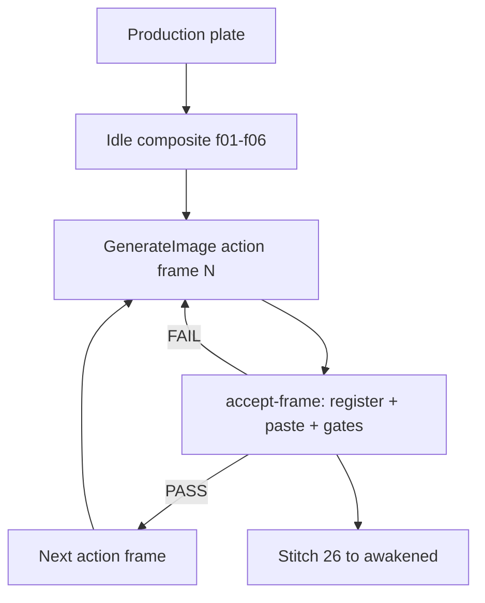

# Avatar Awakening Animation — Style Guide

> **Production status:** Awakenings are **disabled** in the live shop and avatar renderer. Keep this guide for when animation quality is ready; flip `AVATAR_AWAKENINGS_ENABLED` and re-activate `shop_items` rows.

**Canonical process for one continuous Style A Awakening strip per character.**

Product rules: [avatar-awakening-style-guide.md](./avatar-awakening-style-guide.md).  
Character look: [whole-character-avatar-style-guide.md](./whole-character-avatar-style-guide.md).  
**Authoring UI:** [avatar-animation-creator.md](./avatar-animation-creator.md) (`/dev/animations`).

## Product rule

One **Awakening** unlocks one horizontal sprite strip:

**idle → cool action → return to idle frame 1** (loops forever).

- Motion lives **only** in sheet pixels (nearest-neighbor).
- **Do not** use CSS bob, sway, aura rings, particle overlays, or locked-plate offset remappers.
- If no sheet is registered, the static whole-character PNG is shown.

Prefer creating specs in the **Animation Creator**, then generating **action** frames via Cursor `GenerateImage` from the exported job package.

## Default pipeline: GenerateImage-only (plate-composite)

Cursor `GenerateImage` has soft refs + text only (no seed, ControlNet, LoRA, or denoise). Identity must come from **pixels we refuse to let AI redraw**.

| Segment | Frames | Who draws |
| --- | --- | --- |
| Idle | f01–f06 | **No AI body.** [`scripts/avatar-anim-idle-composite.ps1`](../scripts/avatar-anim-idle-composite.ps1) — plate + procedural FX |
| Action | f07–f24 | `GenerateImage` one frame at a time → [`scripts/avatar-anim-accept-frame.ps1`](../scripts/avatar-anim-accept-frame.ps1) |
| Return | f25–f26 | Composite; **f26 = exact plate** |



### GenerateImage rules (action only)

1. Refs always **`[production plate, previous ACCEPTED frame]`** — plate first. Never a whole atlas. Never a raw ungated AI frame.
2. Chroma **`#00FF00`** for pink/plum FX characters (magenta keys eat pink glow).
3. Prompt = **1–3 concrete deltas** from prev only (sword angle, petal chips, arm bend). No freeform “cool combo.”
4. **One frame at a time.** Oneshot multi-cell atlases are draft layout only.
5. On gate FAIL: regenerate that frame; do not continue the chain.

### Accept loop (mandatory after every AI frame)

1. Register + chroma key (green/magenta)  
2. Locked-region paste from plate (head, sash, embroidery) + **hard foot band**  
3. Reject gates (belt, face, shoes, embroidery, head proportion)  
4. Copy pasted result to `seq/fNN.png` as the next soft-ref  

Helper: [`scripts/avatar-anim-accept-frame.ps1`](../scripts/avatar-anim-accept-frame.ps1).

Optional in-betweens: [`scripts/avatar-anim-hold-tween.ps1`](../scripts/avatar-anim-hold-tween.ps1) — petal-only holds from the nearest accepted AI key (no body redraw).

## Strip structure (canonical)

| Segment | Frames | Purpose |
| --- | --- | --- |
| Idle | **6** | Ready stance; secondary FX only. Feet planted. |
| Action | **18** | One readable cool beat (front-facing). |
| Return | **2** | Ease back toward idle; last = exact plate. |

**Total: 26 frames** → sheet **6656×256**  
Path: `public/avatar-characters/style-a/awakened/{slug}.png`

### Do more frames help?

**Only after identity is locked** via paste + gates. Extra frames do not fix redesign drift.

### Resolution

| Stage | Size |
| --- | --- |
| Production plate / composites / accepted | **256×256** |
| Cursor `GenerateImage` raw | Often landscape — accept-frame letterboxes |

## Consistency hard locks

Reject criteria — regenerate before continuing:

1. **Same model** as plate (face/hair/proportions ~2.5 heads)  
2. **Wardrobe** — belt/sash color & shape, garments, shoes, ornaments (paste enforces head/sash/feet)  
3. **Prop hand/side** locked to plate  
4. **No outfit holes**  
5. **Feet / root** — hard foot band from plate after paste  

## Robe-safe processing

[`scripts/process-awakening-strip.ps1`](../scripts/process-awakening-strip.ps1) for final stitch when `seq/` is complete:

1. Magenta **or green** chroma (prefer green for pink FX)  
2. Letterbox → plate-register mid-frames  
3. Lock f01 + last to plate  
4. Continuity audit  

## Draft-only: multi-sheet oneshot

6-cell atlases + bridge cells may help **layout drafts**. They are **not** production identity. Always run cells through `accept-frame` before trusting them.

## Client registry

```ts
avatar_{snake_slug}: { file: '{slug}.png', frames: 26 },
```

`PixelAvatar` plays the sheet when `awakeningLevel >= 1`.

## Test character

**Plum Blossom Blade** — GenerateImage-only pilot under `tmp/animation-jobs/.../gi-pilot/`.  
Plate locks: black sash, white murim robes, sword hand/side, pink petals on green chroma.

## Appendix — external tools (optional later)

ComfyUI ControlNet / video→extract can exceed GenerateImage fluidity. Not required for the default Manhwadle path. See [avatar-sprite-external-pipeline.md](./avatar-sprite-external-pipeline.md) if you opt in later.
