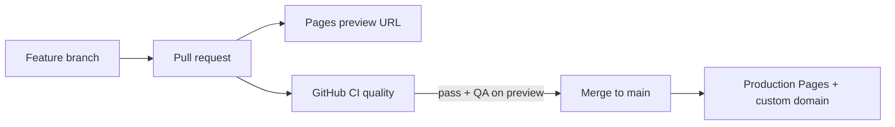

# Deployment

Manhwadle’s production surface is the **player app only** (`index.html` + Vite assets).
Library / character-image tools use `vite.tools.config.ts` and must not ship in `dist/`.

**CI vs CD:** [`.github/workflows/ci.yml`](../.github/workflows/ci.yml) validates every PR and push (lint, tests, production build, e2e). **Cloudflare Pages** (Git integration) builds and deploys — there is no separate deploy Action for v1.

## Environments

| Env | Purpose | Notes |
| --- | --- | --- |
| Local | `npm run dev` | Player app. Tools: `npm run library` / `npm run review:images` |
| Preview | Cloudflare Pages preview deploys (non-`main` branches / PRs) | Same build as production; **Preview** env vars → staging Supabase |
| Staging backend | Separate Supabase project | Apply migrations + Edge Functions here before production |
| Production | Custom domain on Cloudflare Pages (`main` branch) | Merge only after CI + preview QA |



| What you do | What happens |
| --- | --- |
| Push / open a PR on any non-production branch | Pages builds a **preview** URL — production unchanged |
| Merge to production branch (`main`) | Pages builds and atomically swaps **production** |
| Bad front-end release | Pages → Deployments → **Retry** previous successful deploy |

Pages deploys are atomic (near-zero downtime). Downtime risk is mostly **backend** (bad migration / Edge Function), not the Pages swap.

---

## 1. Connect the repo to Cloudflare Pages

In Cloudflare → **Workers & Pages** → **Create** → **Pages** → **Import an existing Git repository** ([krsina/manhwadle](https://github.com/krsina/manhwadle)):

| Setting | Value |
| --- | --- |
| Build command | `npm ci && npm run build` |
| Build output directory | `dist` |
| Root directory | `/` (repository root) |
| Node version | `22` (Pages reads [`.nvmrc`](../.nvmrc); or set `NODE_VERSION=22`) |
| Production branch | `main` |

Notes:

- `npm run build` already runs `build:catalog`; do not ship tools (`vite.tools.config.ts`).
- `_headers` and `_redirects` in `public/` are copied into `dist/`.
- Attach the **custom domain only to production** (not preview URLs).

After the first successful production deploy, confirm `*.pages.dev` and the custom domain both serve the player app.

---

## 2. Split Preview vs Production environment variables

Pages → **Settings** → **Environment variables**. Set **different** values for **Production** and **Preview**:

| Variable | Production | Preview (all PR / non-`main` builds) |
| --- | --- | --- |
| `VITE_SUPABASE_URL` | Live Supabase project URL | **Staging** Supabase project URL |
| `VITE_SUPABASE_ANON_KEY` | Live anon / publishable key | Staging anon / publishable key |
| `VITE_SENTRY_DSN` | Optional | Optional (same or unset) |
| `VITE_SENTRY_ENVIRONMENT` | `production` | `preview` |

Never set `SUPABASE_SERVICE_ROLE_KEY` (or any service-role secret) in Vite / Pages browser env.

Preview builds must not write ranked / auth / puzzle state into the live DB. Create a dedicated staging Supabase project before relying on preview auth or ranked flows.

Ads vars (`VITE_ADS_*`, etc.) — see [ads.md](./ads.md); prefer enabling them only on Production until ready.

---

## 3. Supabase Auth URL allow-list

Hosted projects: **Authentication → URL Configuration** (not only `supabase/config.toml`, which is for local CLI).

On **both** staging and production Supabase projects, allow:

| Purpose | Redirect URL |
| --- | --- |
| Local Vite | `http://localhost:5173/**` |
| Pages previews + project subdomain | `https://*.pages.dev/**` |
| Production custom domain | `https://<your-production-domain>/**` |

Site URL:

- Staging project: staging Pages URL or `http://localhost:5173`
- Production project: production origin (custom domain)

Social providers (Google / Discord): each provider console must allow the Supabase callback  
`https://<project-ref>.supabase.co/auth/v1/callback` — see [.env.example](../.env.example).

---

## 4. Protect `main` (GitHub)

So WIP cannot go live by accident: GitHub → **Settings** → **Branches** → Branch protection rule on `main`:

- Require a pull request before merging (no direct push)
- Require status checks to pass: **`quality`** (workflow job name from CI)
- Optionally require 1 approving review
- Do not allow bypassing for admins unless you intentionally need an emergency override

Once [GitHub CLI](https://cli.github.com/) is logged in (`gh auth login`), you can apply the same rule:

```bash
gh api -X PUT repos/krsina/manhwadle/branches/main/protection \
  -H "Accept: application/vnd.github+json" \
  -f required_status_checks='{"strict":true,"contexts":["quality"]}' \
  -F enforce_admins=true \
  -F required_pull_request_reviews='{"required_approving_review_count":0}' \
  -F restrictions=null \
  -F allow_force_pushes=false \
  -F allow_deletions=false
```

(Adjust review count / admin enforce to match your preference. The required check name must match the CI job id `quality` after it has run at least once on the default branch.)

---

## 5. Day-to-day release habit (minimal downtime)

Commit / PR / merge habits (preflight, green-before-merge, common CI failures): [git-pr-flow-style-guide.md](./git-pr-flow-style-guide.md).

Docs / `art/` / markdown-only PRs skip the full `quality` job via `paths-ignore` in [`.github/workflows/ci.yml`](../.github/workflows/ci.yml) (live assets are under `public/`).

1. Branch off `main` → develop locally (`npm run dev`).
2. Open a PR → Cloudflare posts a **preview URL**; GitHub **CI / quality** runs.
3. QA on the preview (staging Supabase).
4. If the change needs schema or Edge Functions:
   1. Apply migrations / deploy functions to **staging** Supabase first.
   2. Verify on the Pages preview.
   3. Apply the same to **production** Supabase (or immediately before merging the app that depends on it).
   4. Only then merge the front-end to `main`.
5. Merge → wait for Pages **production** deploy → spot-check the live URL.
6. Keep the previous deployment ID handy. On regression: **Retry** that deployment immediately.

### Release checklist

- [ ] PR green (`quality` job)
- [ ] Preview looks good against staging backend
- [ ] Production Supabase ready (migrations / functions) if required
- [ ] Merge to `main` → Pages production deploy finished
- [ ] Spot-check live URL
- [ ] On failure: Pages → Deployments → retry previous successful deployment

### Rollback

1. Cloudflare Pages → Deployments → retry previous successful deployment (instant rollback).
2. If a bad migration shipped, restore DB from backup **before** re-promoting app code that depends on it — see [backups & keys](./runbooks/backups-and-keys.md).
3. Keep the prior deployment ID in the incident notes — see [uptime & incidents](./runbooks/uptime-and-incidents.md).

Pages rollback does **not** undo Supabase migrations.

---

## Prelaunch checks

```bash
npm run check:contact   # fails while contact placeholder remains
npm run check:dist      # tools/audits excluded + bundle budgets
```

Configure `src/lib/siteContact.ts` before production.

## Optional later: staging smoke in CI

[`.github/workflows/ci.yml`](../.github/workflows/ci.yml) has a `staging-smoke` job stubbed with `if: false`. After you have a durable staging Supabase project and GitHub secrets (`STAGING_SUPABASE_URL`, keys), remove `if: false` and wire `npm run test:live` / `test:live:auth` / `test:live:security` so merges are gated on live staging smokes. Use **staging-only** secrets — never production service role keys. Security negatives also require `SECURITY_SMOKE_TARGET` + `SECURITY_SMOKE_ACK_NON_PRODUCTION` and refuse denylisted production project refs; see [security-negatives-staging.md](./runbooks/security-negatives-staging.md) and [moderation.md](./moderation.md).

## What you do not need for v1

- A second GitHub Actions “deploy” workflow (Pages Git integration already deploys)
- Wrangler / Workers project for the static SPA
- Downtime windows for normal UI-only releases

## 6. Hosted Auth & Edge Function settings (dashboard / secrets)

These controls are **not fully expressible in git** for hosted projects. Apply on **both** staging and production Supabase projects before final rollout. Do not commit secret values.

### Dashboard Auth (cannot commit)

| Setting | Where | Action |
| --- | --- | --- |
| Redirect / Site URL allow-list | Authentication → URL Configuration | Same origins as [§3](#3-supabase-auth-url-allow-list) |
| Leaked-password protection | Authentication → Attack Protection (or Password security) | Enable HaveIBeenPwned / leaked-password checks for email signup & password change |
| CAPTCHA | Authentication → Attack Protection / CAPTCHA | Enable hCaptcha or Turnstile; store provider secrets in project secrets only |
| Auth rate limits | Authentication → Rate Limits | Tighten email OTP / signup / recovery for production |
| Before User Created hook | Authentication → Hooks | Point at `public.hook_before_user_created` after roles/moderation migrations — see [moderation.md](./moderation.md) |

For production, CAPTCHA and tightened signup/OTP limits are required parts of
Versus abuse protection, not optional polish. Database controls bound work per
account, while Auth attack protection raises the cost of creating many accounts
to evade those limits. Verify both settings in staging before enabling them in
production, and keep the local security-smoke admin flow available for tests.

Versus also enforces server-side safeguards:

- one active room per account;
- at most 6 room creations per 10 minutes and 100 per 24 hours;
- progressive 15-minute / 1-hour cooldowns after repeated first-round abandonment;
- 8-character invite codes (legacy 6-character codes remain valid briefly);
- 15-minute completed-match delivery and 5-minute cancelled/expired retention;
- one-hour, 128-row idempotency storage per account.

Run `npm run test:live:multiplayer:security` only with the guarded local/staging
credentials documented for security negatives. The command rejects the known
production project.

### Edge Function env (hosted secrets — no values in repo)

| Secret / env | Used by | Notes |
| --- | --- | --- |
| `CORS_ALLOWED_ORIGINS` | `moderation`, `account-data` | Comma-separated browser origins (exact or `https://*.pages.dev`). Unset locally → `http://localhost:5173` + `http://127.0.0.1:5173` only. Never `*`. |
| `CRON_SECRET` | `select-daily-puzzles` | Required. Call with `x-cron-secret` or `Authorization: Bearer <CRON_SECRET>`. |
| Platform `SUPABASE_*` keys | all functions | Auto-injected on hosted; never put service role in Vite / Pages |

### `verify_jwt` (repository-controlled in `supabase/config.toml`)

| Function | `verify_jwt` | Why |
| --- | --- | --- |
| `account-data` | `true` | User JWT; subject from `auth.getUser(jwt)` only |
| `moderation` | `true` | User JWT; actor from `auth.getUser(jwt)` only; rejects body `actor_id` / `user_id` |
| `select-daily-puzzles` | `false` | Custom cron / service-role auth inside the function — platform JWT gate would block legitimate cron |

After changing function config or code: deploy functions to staging first (`supabase functions deploy …`), then production.

### Owner analytics

The private `/staff` dashboard reads signed-in aggregate metrics through the JWT-verified
`moderation` function. The database rechecks the live Owner role, caps requests to 90 UTC days,
rate-limits and audits queries, and returns no user IDs, emails, guesses, or answer IDs.
Anonymous guest play is intentionally not collected.

## Related runbooks

- [Uptime & incidents](./runbooks/uptime-and-incidents.md)
- [Backups & key rotation](./runbooks/backups-and-keys.md)
- [Daily puzzles](./runbooks/daily-puzzles.md)
- [Moderation incidents](./runbooks/moderation-incidents.md)
- [Security negatives (staging)](./runbooks/security-negatives-staging.md)
- [Migration drift](./runbooks/migration-drift.md)
